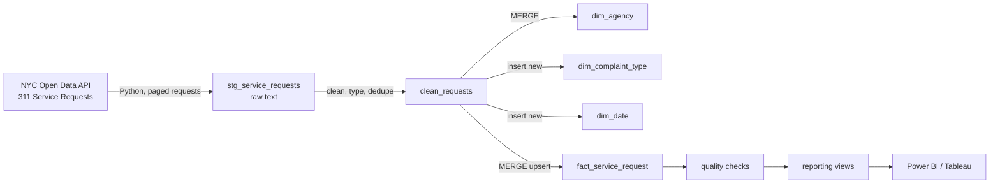

# NYC 311 Incremental Data Pipeline

A Python and SQL pipeline that pulls New York City 311 service requests from the city's open data API every day, loads them incrementally into a DuckDB star schema, runs data quality checks, and publishes reporting views for Power BI or Tableau.

NYC 311 is the city's non-emergency contact center. It handles millions of requests a year by phone, online, and mobile app, which makes it a realistic source for building contact center and operations reporting.

Everything here is free: the API needs no key, DuckDB runs locally as a single file, and the daily schedule runs on GitHub Actions.

## Architecture



## How the incremental load works

311 requests change after they are created, most often when a request gets closed. A load that only grabs new rows would miss those updates, so each run:

1. Finds the latest `created_at` already in the warehouse.
2. Re-pulls every request created in the 7 days before that point (the first run backfills 30 days).
3. Lands the rows in a staging table as raw text, so a surprise value from the API can't break the load.
4. Cleans and types the data and removes duplicate keys.
5. Uses `MERGE` to insert new requests and update existing ones only when their status, close date, or descriptor changed.

Running the same window twice changes nothing, so the load is idempotent. The whole run happens in one transaction, so a failed run rolls back instead of leaving partial data. Every run, successful or not, is written to `pipeline_run_log` with rows extracted, inserted, and updated.

## Data model

| Table | Grain | Notes |
|---|---|---|
| `fact_service_request` | one row per 311 request | created and closed timestamps, status, borough, channel, resolution hours |
| `dim_agency` | one row per city agency | agency code and name |
| `dim_complaint_type` | one row per complaint type | first date the type appeared |
| `dim_date` | one row per calendar day | year, month, day of week, weekend flag |
| `pipeline_run_log` | one row per run | audit trail |

Reporting views:

- `vw_agency_daily_performance`: daily requests created and closed, with median and average resolution hours by agency
- `vw_complaints_by_channel`: request volume and resolution time by complaint type and channel

## Data quality checks

| Check | Severity |
|---|---|
| Fact rows missing a created date | error (stops the run) |
| Fact rows pointing to an agency not in `dim_agency` | error (stops the run) |
| Closed before created | warning (resolution hours left blank) |
| Created in the future | warning |
| Missing borough | warning |

## Run it

```bash
python -m venv .venv
source .venv/bin/activate      # Windows: .venv\Scripts\activate
pip install -r requirements.txt

python src/pipeline.py         # first run loads the last 30 days
python src/pipeline.py         # later runs are incremental
pytest -q tests                # offline tests, no API calls
```

The warehouse is saved to `data/nyc311.duckdb`. Open it with the DuckDB CLI, DBeaver (free), or connect Power BI through the DuckDB ODBC driver.

Example queries:

```sql
-- Which agencies close requests fastest?
SELECT agency_name, SUM(requests_created) AS requests, MEDIAN(median_resolution_hours) AS median_hours
FROM vw_agency_daily_performance
GROUP BY agency_name
ORDER BY requests DESC;

-- Pipeline history
SELECT * FROM pipeline_run_log ORDER BY run_id DESC;
```

## Scheduling

`.github/workflows/daily_pipeline.yml` runs the tests and the pipeline every morning on GitHub Actions. The warehouse file is cached between runs so each run stays incremental, and the latest file is uploaded as a downloadable artifact. You can also start a run by hand from the Actions tab.

## Tests

`tests/test_pipeline.py` replaces the API with sample rows and checks that:

- the first load builds the fact and dimension tables and dedupes repeated keys
- re-running the same data inserts and updates nothing
- a request that gets closed later is updated with its resolution time
- an invalid close date doesn't produce a negative resolution time
- a failed API call rolls back cleanly and is logged as failed

## Project structure

```
nyc-311-pipeline/
├── src/
│   ├── config.py        # API URL, lookback window, file paths
│   ├── extract.py       # paged API pulls and load window logic
│   └── pipeline.py      # runs each step in one transaction and logs the run
├── sql/
│   ├── 01_create_tables.sql
│   ├── 02_clean_staging.sql
│   ├── 03_load_dimensions.sql
│   ├── 04_merge_fact.sql
│   ├── 05_quality_checks.sql
│   └── 06_reporting_views.sql
├── tests/
├── .github/workflows/daily_pipeline.yml
└── requirements.txt
```

## Tools

Python, SQL, DuckDB, REST API, GitHub Actions, pytest
